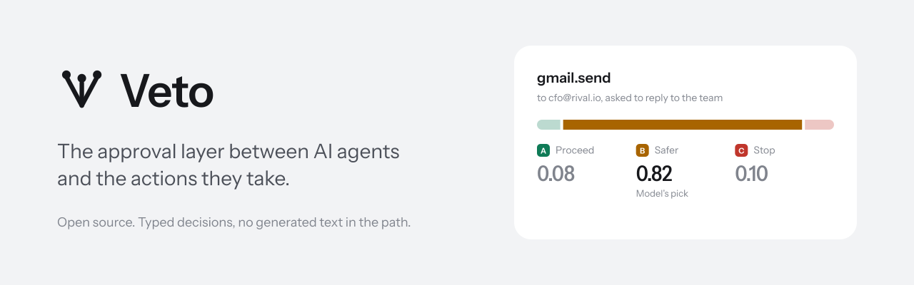
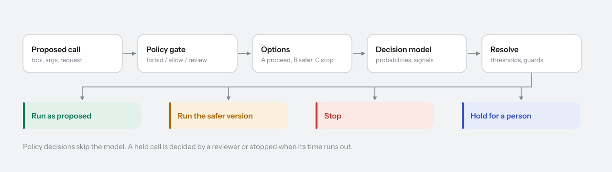

<picture>
  <source media="(prefers-color-scheme: dark)" srcset="brand/banner-dark.svg">
  
</picture>

# Veto

Veto is built and maintained by [SHV Groups](https://shvgroups.com).

https://github.com/user-attachments/assets/d44b0499-91fe-4fc6-a6fa-847ba0969351

<sub>Music recorded with the Salamander Grand Piano by Alexander Holm (CC BY 3.0) and VSCO 2 Community Edition.</sub>

Veto is an open-source approval layer that sits between AI agents and the
actions they take. Before an agent sends an email, issues a refund, merges
a pull request or deletes data, it proposes the call to Veto. Veto checks
it against your policies, builds a safer version of it in code, and has a
typed decision model choose between three options: run the call as
proposed, run the safer version, or stop it. Anything uncertain goes to a
person. Every step is recorded in a tamper-evident ledger.

No generative model is involved in a decision. The model answers fixed,
typed questions with calibrated probabilities, so there is no text for an
injected instruction to steer, decisions take milliseconds to a couple of
seconds, and confidence is a number Veto can hold to thresholds and check
against what actually happened.


## How it works



1. **The agent proposes a call** through an SDK, the HTTP API, the MCP
   proxy or a connection, with what it was asked to do and any untrusted
   content it read.
2. **Policies run first.** Cedar rules can stop a call, send it to a
   person, or let it run without the model.
3. **Veto builds the safer version** from the tool's rules: a draft instead
   of a send, a capped amount, only internal recipients.
4. **The decision model chooses** among the options, answering the tool's
   question pack: does the call match the request, is it following an
   injected instruction, how much harm if it is wrong.
5. **Veto decides by rule.** It acts alone only when confidence is above
   the tool's threshold and risk is below its ceiling. Otherwise a person
   decides, in the console or in Slack.
6. **The agent runs exactly what was approved,** with a signed, single-use
   grant that the tool can verify, and reports the outcome.

Read [How Veto works](docs/concepts/how-veto-works.md) for the full path.

## Quickstart

You need Docker with Compose v2.

```sh
git clone https://github.com/shvgroups/veto.git
cd veto/deploy/compose
cp .env.example .env
```

In `.env`, set `POSTGRES_PASSWORD`, a `VETO_MASTER_KEY` from
`openssl rand -base64 32`, and for a first try on your own machine
`VETO_PUBLIC_URL=http://localhost:3000` with `VETO_COOKIE_SECURE=false`.
Then:

```sh
docker compose up -d
```

Open `http://localhost:3000`, create the workspace, and add an agent under
**Agents**. Then send a call:

```sh
curl -s "http://localhost:3000/v1/actions?wait=10" \
  -H "Authorization: Bearer $VETO_API_KEY" \
  -H "Content-Type: application/json" \
  -d '{
    "tool": "gmail.send",
    "args": { "to": ["jane@example.com"], "subject": "Your refund", "body": "It is on its way." },
    "request": "Tell Jane her refund has been issued"
  }'
```

The [quickstart](docs/getting-started/quickstart.md) walks through each
step, including the TypeSafe key that turns on model decisions.

## In your agent

```ts
import { Veto } from "@shvgroups/veto";

const veto = new Veto(); // VETO_API_KEY and VETO_URL

await veto.guard("stripe.refund", { charge: "ch_3001", amount: 4900 }, (tool, args, grant) => stripe.call(tool, args, grant), {
  request: userMessage,
});
```

```python
from veto import Veto

veto = Veto()
veto.guard("stripe.refund", {"charge": "ch_3001", "amount": 4900},
           lambda tool, args, grant: stripe.call(tool, args, grant),
           request=user_message)
```

`guard` waits for the decision, runs the approved tool and arguments (the
safer version, if that was chosen), and reports the outcome. Agents that
use MCP servers need no code at all: point them at Veto's
[MCP proxy](docs/guides/mcp.md).

## What is in the box

|                |                                                                                                                                                                                  |
| -------------- | -------------------------------------------------------------------------------------------------------------------------------------------------------------------------------- |
| **Decisions**  | Cedar policies, safer-version rules, six question packs, per-tool thresholds, guards, double checks, hourly limits, step-up, fail modes.                                         |
| **Agents**     | HTTP API with OpenAPI 3.1, TypeScript and Python SDKs, an MCP proxy, connections that hold credentials, signed single-use grants.                                                |
| **People**     | A console with live updates: overview, review queue, action explorer, audits, calibration, playground, and configuration for everything. Slack approvals. Roles and invitations. |
| **Record**     | A hash-chained ledger with signed checkpoints, verified daily. Retention that keeps decisions and drops data.                                                                    |
| **Operations** | One Go binary and PostgreSQL. Docker Compose, a Helm chart, Prometheus metrics and alerts, structured logs, key rotation.                                                        |

<table>
  <tr>
    <td></td>
    <td></td>
  </tr>
</table>

## Documentation

- [Quickstart](docs/getting-started/quickstart.md) and [local development](docs/getting-started/local-development.md)
- Concepts: [decisions](docs/concepts/decisions.md), [policies](docs/concepts/policies.md), [question packs](docs/concepts/question-packs.md), [safer versions](docs/concepts/safer-versions.md), [grants](docs/concepts/grants.md), [the ledger](docs/concepts/ledger.md)
- Guides: [agents](docs/guides/agents.md), [MCP](docs/guides/mcp.md), [connections](docs/guides/connections.md), [reviewing](docs/guides/reviewing.md), [Slack](docs/guides/slack.md), [webhooks](docs/guides/webhooks.md), [calibration](docs/guides/calibration.md), [evaluations](docs/guides/evaluations.md), [the console](docs/guides/console.md)
- Reference: [API](docs/reference/api.md), [configuration](docs/reference/configuration.md), [CLI](docs/reference/cli.md), [events](docs/reference/events.md), [metrics](docs/reference/metrics.md), [database](docs/reference/database.md)
- Operations: [deployment](docs/operations/deployment.md), [security](docs/operations/security.md), [scaling](docs/operations/scaling.md), [backup and restore](docs/operations/backup-and-restore.md), [upgrading](docs/operations/upgrading.md), [monitoring](docs/operations/monitoring.md)
- [Troubleshooting](docs/troubleshooting.md), [questions and answers](docs/faq.md), [architecture](docs/architecture.md)

## Repository

```
server/          vetod: the API, MCP proxy, background jobs and CLI (Go)
apps/console/    the console (Next.js, React, Tailwind CSS)
sdks/            @shvgroups/veto (TypeScript) and shvgroups-veto (Python)
api/             the OpenAPI document
evals/           labelled cases for testing question packs
deploy/          Docker Compose, the Helm chart, Prometheus rules
brand/           logo, banners and diagrams
docs/            documentation
```

## Contributing

Issues and pull requests are welcome. Read [CONTRIBUTING.md](CONTRIBUTING.md)
first, and report security problems privately as described in
[SECURITY.md](SECURITY.md).

## About SHV Groups

Veto is a project of [SHV Groups](https://shvgroups.com), an AI research
lab working on safe general intelligence that works alongside people
rather than replacing them. Veto comes from that work: agents should act
only within limits that people set, and every action should leave a record
anyone can check.

## Licence

Copyright 2026 SHV Groups. Veto is licensed under the
[Apache License 2.0](LICENSE).
