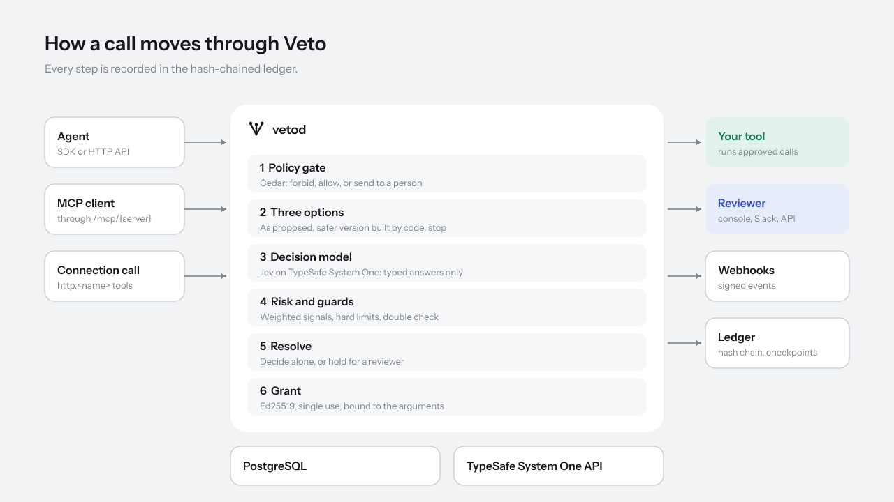

# Architecture

This page is for people working on Veto's code. It describes how the
repository is organised, how one action moves through the server, and the
decisions behind the design. For how Veto behaves from the outside, start
with [How Veto works](concepts/how-veto-works.md).



## Repository

| Path               | Contents                                                                                                        |
| ------------------ | --------------------------------------------------------------------------------------------------------------- |
| `server/`          | vetod, in Go. One binary: the agent API, the console API, the MCP proxy, background jobs and operator commands. |
| `apps/console/`    | The console: Next.js App Router, React, Tailwind CSS, TanStack Query.                                           |
| `sdks/typescript/` | `@veto/sdk`, with no runtime dependencies.                                                                      |
| `sdks/python/`     | `veto-sdk`, sync and async clients on `httpx`.                                                                  |
| `api/openapi.yaml` | The HTTP API. A server test fails if a route is missing from it.                                                |
| `evals/`           | Labelled cases for `vetod eval`, one file per built-in pack.                                                    |
| `brand/`           | The logo, banners, diagrams and illustrations, generated by `brand/build.py`.                                   |
| `deploy/`          | Docker Compose, the Helm chart and Prometheus rules.                                                            |
| `docs/`            | This documentation.                                                                                             |

The JavaScript side is a pnpm workspace driven by turbo. The Go module is
self-contained; `make` ties the two together.

## Server packages

Dependencies point one way: from the edges (`cmd`, `httpapi`, `mcp`,
`worker`) through `app` to pure packages that do no I/O. Nothing below
`app` imports `app`.

```
cmd/vetod
  ├── httpapi ──┐
  ├── mcp ──────┤
  └── worker ───┴── app ── store ── (PostgreSQL)
                     ├──── events (LISTEN/NOTIFY)
                     ├──── jev (the decision model's API)
                     ├──── connector, notify (outbound HTTP)
                     ├──── vault, auth, grant, ledger
                     └──── decide, policy, safer, canonical, domain   (pure)
```

| Package                      | Responsibility                                                                                                                                                                                                                                   |
| ---------------------------- | ------------------------------------------------------------------------------------------------------------------------------------------------------------------------------------------------------------------------------------------------ |
| `domain`                     | The shared vocabulary: tools, risk classes, actions and their lifecycle, the three options, decisions and reason codes. Plain data and pure rules.                                                                                               |
| `canonical`                  | RFC 8785 canonical JSON and the arguments hash, so one call always hashes the same way whatever its key order or number formatting.                                                                                                              |
| `policy`                     | Compiles Cedar policies, checks Veto's annotations, builds the Cedar request from an action, and evaluates it.                                                                                                                                   |
| `safer`                      | Builds option B from a tool's rules, with a one-line description of each change.                                                                                                                                                                 |
| `decide`                     | Question packs; builds the model's state and questions; reads typed answers into an assessment (confidence, risk, guards); applies the decision rules. The rules are pure functions so every decision can be replayed.                           |
| `jev`                        | The client for TypeSafe's System One API: retries, fallbacks and the time budget.                                                                                                                                                                |
| `grant`                      | Issues and verifies Ed25519-signed grants.                                                                                                                                                                                                       |
| `ledger`                     | Entry hashing, chain verification and checkpoint messages.                                                                                                                                                                                       |
| `vault`                      | AES-256-GCM sealing with the master key, previous keys for rotation, and row-bound associated data.                                                                                                                                              |
| `auth`                       | argon2id password hashing and opaque token generation.                                                                                                                                                                                           |
| `id`                         | Prefixed, time-sortable ids (`act_`, `agt_`, ...) built on ULIDs.                                                                                                                                                                                |
| `store`                      | All SQL. Methods live on `Queries`, which wraps either the pool or a transaction. Embedded migrations.                                                                                                                                           |
| `events`                     | Publishes events inside transactions with `pg_notify` and fans them out to subscribers in every replica.                                                                                                                                         |
| `connector`                  | Outbound HTTP for connections and webhooks, through a transport that refuses private destinations unless allowed.                                                                                                                                |
| `notify`                     | Webhook signing and delivery, and the Slack client.                                                                                                                                                                                              |
| `app`                        | Every operation: submitting and deciding actions, reviews, audits, outcomes, grants, and administration. The only package that combines the store, the decision engine, the vault and the event bus, and the only place permissions are checked. |
| `httpapi`                    | Routes, authentication, CSRF and origin checks, rate limits, request logging, JSON encoding of errors, the event stream, health and metrics. No business rules.                                                                                  |
| `mcp`                        | The MCP Streamable HTTP proxy.                                                                                                                                                                                                                   |
| `worker`                     | Background jobs.                                                                                                                                                                                                                                 |
| `metrics`                    | A small Prometheus text-format implementation.                                                                                                                                                                                                   |
| `config`                     | Environment variables, validated all at once.                                                                                                                                                                                                    |
| `eval`                       | The offline evaluation harness behind `vetod eval`.                                                                                                                                                                                              |
| `apptest`, `store/storetest` | Test helpers: a wired `App` on a real database with a scripted model.                                                                                                                                                                            |

## One action, through the code

1. **`httpapi`** authenticates the agent key, applies the per-key rate
   limit, decodes the body into `app.SubmitRequest` and calls
   `app.Submit`.
2. **`app.Submit`** validates limits, computes the arguments hash with
   `canonical`, and returns the existing action if the idempotency key was
   seen before. Otherwise, in one transaction, it inserts the action
   (status `evaluating`), registers the tool if it is new, appends
   `action.received` to the ledger and publishes an event.
3. **`app.evaluate`**, outside any transaction, does the slow part:
   - `policy` evaluates the active Cedar policy set;
   - the tool's hourly limit is checked;
   - `safer` builds option B;
   - if policies did not decide, `decide` builds the state and questions
     from the tool's pack, `jev` asks the model, and `decide` turns the
     answers into an assessment. For tools with the double check on, the
     disposition is asked a second time, in parallel, with the options in
     reverse order;
   - `decide.Resolve` applies the rules and returns a verdict: an option,
     or a hold, with reasons.
4. **`app.applyEvaluation`**, in a second transaction, stores every
   evaluation (with the exact model request and response), and either
   finalises the decision (decision row, grant, ledger entries, audit
   sampling, webhook) or marks the action `pending_review` with a
   deadline.
5. Events published in that transaction reach every replica once it
   commits. A request waiting with `?wait=` is subscribed to them and
   returns the result; the console's stream invalidates the right queries.

A review (`app.Review`) is step 4 with a person's choice instead of the
model's. Finalising is a conditional update that succeeds only while the
action is still undecided, so a reviewer, Slack and expiry racing for the
same action produce exactly one decision; the others get a conflict.

## Design decisions

### A typed decision model, not a generative one

The model answers multiple-choice and yes-or-no questions with calibrated
probabilities. No text is generated, so there is nothing for an injected
instruction to shape, decisions are fast, and confidence is a number Veto
can hold to thresholds and calibrate against audits. Everything that can
be decided in code (amount limits, schedules, who may do what) is decided
in code first: Cedar policies and safer-version rules.

### One binary with roles

An early design split Veto into a gateway, a decision service and a
worker. In practice they share every type, every query and the same
database, and splitting them added network hops and deployment work for no
isolation benefit. vetod is one binary; `VETO_WORKERS=false` turns a
replica into a pure API server, and the Helm chart can run dedicated
worker pods. If a part ever needs to scale independently, the package
boundaries already allow it.

### REST and OpenAPI

The early design considered ConnectRPC. Agents are written in every language and
often by people who will only ever use `curl`; a plain JSON API with an
OpenAPI document reaches all of them, the SDKs stay dependency-free, and
the MCP proxy and webhooks are HTTP anyway. A test keeps the document and
the route table in step.

### PostgreSQL is the only dependency

Queues, locks, events and the ledger all live in PostgreSQL:
`LISTEN`/`NOTIFY` for events, advisory locks for singleton jobs, row
leases (`FOR UPDATE SKIP LOCKED`) for webhook delivery, and a row lock on
`ledger_heads` to keep each chain linear. One stateful system is easier to
run, back up and reason about than several, and Veto's write volume is
well within what PostgreSQL handles.

### Two transactions per action

The model call takes most of a decision's time. Holding a transaction and
a connection open across it would tie the database pool to the model's
latency. Receiving and deciding are therefore separate transactions, and
the conditional status update makes the second one safe against races.

### Decisions are replayable

`decide.Resolve` is a pure function of the assessment, the tool's
thresholds and the policy outcome. Each evaluation stores the inputs, so
the console can show exactly why a decision went the way it did, the
playground can show what Veto would do without recording anything, and the
tests can pin the rules down case by case.

### The ledger is written in the same transaction as the change

Every ledger entry is appended inside the transaction that makes the
change it records. There is no window in which a change exists without its
entry, and no separate log to drift out of step.

### Small, deliberate dependencies

The server depends on pgx, cedar-go, the ULID package and
`golang.org/x/crypto`. Metrics, canonical JSON and the Jev client are
written here, because each is small and sits on a security-sensitive path
where it is worth knowing every line.

### The console is a client of the same API

The console holds no database connection and no secrets. Its server only
renders pages and forwards `/v1` and `/mcp` to vetod (`proxy.ts`), which
keeps the browser on one origin, so cookies are first-party and the CSRF
model stays simple. Everything the console shows is available to scripts
through the same endpoints with an admin key.

## Console structure

| Path                      | Contents                                                                                         |
| ------------------------- | ------------------------------------------------------------------------------------------------ |
| `app/(auth)/`             | Sign-in, first-run setup, invitations.                                                           |
| `app/(console)/`          | One folder per page. `page.tsx` is a thin server component; the interactive part sits beside it. |
| `src/lib/api.ts`          | The fetch wrapper: credentials, the CSRF header, typed errors.                                   |
| `src/lib/queries.ts`      | Query keys and hooks for every endpoint.                                                         |
| `src/lib/live.tsx`        | The event stream; each event invalidates the queries it affects.                                 |
| `src/components/ui/`      | Buttons, forms, panels, tables, dialogs, toasts.                                                 |
| `src/components/charts/`  | SVG charts built on d3-scale and d3-shape, sized to their container.                             |
| `src/components/actions/` | The pieces of an action's record, shared by the review queue and the action page.                |
| `src/components/shell/`   | The sidebar, header, command menu and session.                                                   |

Design tokens (colour, type, spacing, radius) are CSS variables in
`app/globals.css`, exposed to Tailwind with `@theme`, with a dark theme
that follows the system unless the user picks one.

## Testing

| Layer                               | How                                                                                                                       |
| ----------------------------------- | ------------------------------------------------------------------------------------------------------------------------- |
| Pure packages                       | Table-driven unit tests: canonical JSON vectors, decision rules, pack validation, grant and ledger tampering.             |
| `store`, `app`, `worker`, `httpapi` | Run against a real PostgreSQL database created per test (`VETO_TEST_DATABASE_URL`), with a scripted model from `apptest`. |
| OpenAPI                             | A test compares the document's paths and methods with the route table.                                                    |
| Console                             | Vitest for formatting, JSON and permission helpers; `tsc` and ESLint with the React compiler rules; `next build`.         |
| SDKs                                | Each against a mock HTTP server: retries, idempotency, waiting, errors, `guard`.                                          |
| Packs                               | `vetod eval` with the cases in `evals/`.                                                                                  |

CI runs all of these on every pull request, plus `helm lint` and the
container builds.
