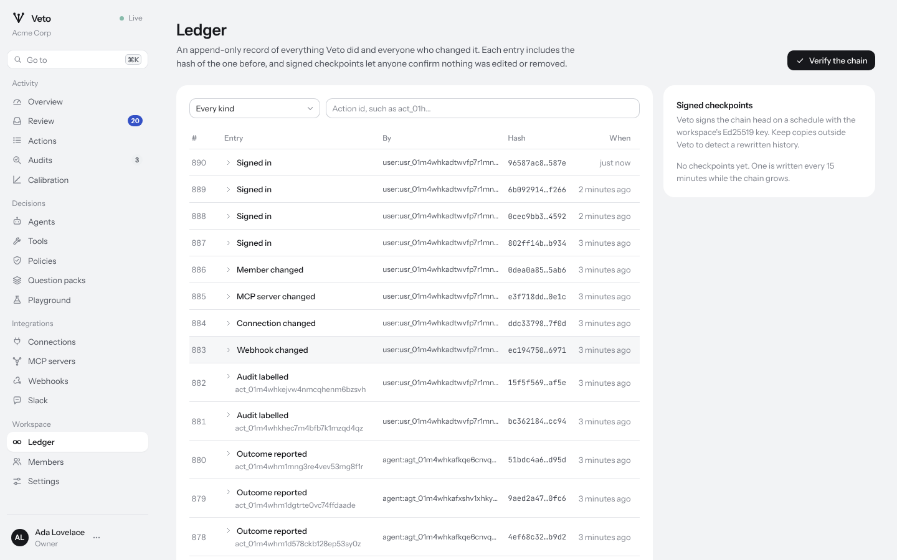

# The ledger

Everything Veto does, and every change anyone makes to it, is written to a
per-workspace ledger: an append-only list of entries in which each entry
includes the hash of the one before. Changing or deleting any entry breaks
every hash after it, and Veto can tell where.



## What is recorded

Action events: `action.received`, `action.held`, `action.decided`,
`action.expired`, `grant.issued`, `grant.consumed`, `action.executed`,
`outcome.reported`, `audit.sampled` and `audit.recorded`.

Configuration and access: `policy.created`, `policy.activated`,
`pack.updated`, `tool.updated`, `tool.deleted`, `agent.created`,
`agent.updated`, `key.created`, `key.revoked`, `connection.changed`,
`mcp_server.changed`, `webhook.changed`, `integration.changed`,
`member.changed`, `settings.updated`, `session.created`,
`workspace.created` and `signing_key.rotated`.

Each entry has a sequence number, a kind, the action it concerns (if any),
the actor (`user:usr_...`, `agent:agt_...`, `key:key_...` or `system`), a
JSON payload and a time. Payloads hold hashes and identifiers rather than
secrets: an action's entry records its arguments hash, not the arguments.

## The hash

Each entry's hash is SHA-256 over these fields, each prefixed with its
length as an 8-byte big-endian integer:

1. the string `veto.ledger.v1`
2. the workspace id
3. the sequence number, 8 bytes big-endian
4. the kind
5. the action id, or empty
6. the actor
7. the payload in canonical JSON
8. the time, UTC, RFC 3339 with microseconds
9. the previous entry's hash; for the first entry, SHA-256 of `veto.ledger.genesis\n` followed by the workspace id

Entries are appended under a row lock on the workspace's chain head, so
concurrent writers always produce one unbroken chain.

## Checkpoints

Every fifteen minutes, if the chain has grown, Veto signs its head with the
workspace's Ed25519 key. The signed message is:

```
veto.ledger.checkpoint.v1
<workspace id>
<sequence number>
<head hash in hex>
```

A chain rebuilt from scratch by someone with database access would have
consistent hashes, but not your earlier checkpoint signatures. Export
checkpoints somewhere outside Veto's database (a webhook consumer or a
scheduled `GET /v1/ledger` works) to make that detectable.

## Verifying

- In the console: **Ledger**, then **Verify the chain**.
- From the command line: `vetod ledger verify` checks every workspace and
  exits non-zero if any chain is broken.
- Automatically: vetod verifies every workspace once a day and sends a
  `ledger.verification_failed` webhook when a chain breaks.

A report gives the number of entries, the head, the first broken entry and
why it failed, and whether the latest checkpoint's signature is valid.

## Retention

The workspace's retention setting (90 days by default) removes, after that
time, each decided action's arguments, request text, untrusted content and
context, the arguments of its options and of the approved call, and the
model requests and responses that contained them. Ledger entries are not
removed: they never held that content, and their hashes still prove what
was decided.
