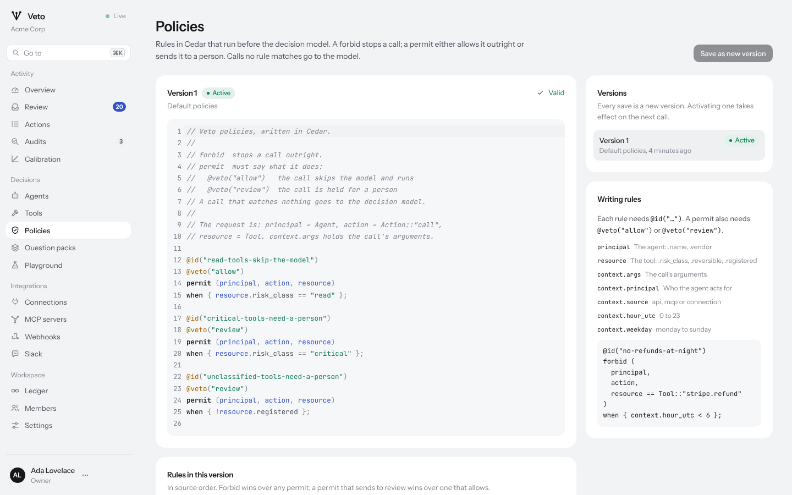

# Policies

Policies are rules you write in [Cedar](https://www.cedarpolicy.com) that
run before the decision model. They are deterministic, fast, versioned, and
the right place for anything that must always hold.

## What a rule does

| Rule                            | Effect                                               |
| ------------------------------- | ---------------------------------------------------- |
| `forbid`                        | Stops the call. Nothing else is consulted.           |
| `permit` with `@veto("allow")`  | Runs the call as proposed, without asking the model. |
| `permit` with `@veto("review")` | Sends the call to a person.                          |
| no rule matches                 | The decision model decides.                          |

When several rules match, `forbid` wins over everything, then `review`,
then `allow`. Every rule needs an `@id("...")`, which is what appears in
decisions, the ledger and the console. A `permit` without a `@veto`
annotation is rejected when you save, so a careless rule can never wave
calls through, and a `forbid` with one is rejected because it would mean
nothing.

If a `forbid` rule fails to evaluate for a call, for example because it
reads an argument that call does not have, Veto holds the call for a person
rather than let it through, and records the error.

## The request

Every call is evaluated as:

- `principal`: the agent, an entity of type `Agent`, with attributes
  `name` and `vendor`;
- `action`: always `Action::"call"`;
- `resource`: the tool, an entity of type `Tool` named after it, with
  attributes `risk_class` (`"read"`, `"low"`, `"medium"`, `"high"`,
  `"critical"`), `reversible` and `registered`;
- `context`:
  - `args`: the call's arguments as a record. Integers become `Long`,
    fractions become `decimal`, and null fields are dropped, so use `has`
    before reading an optional argument;
  - `principal`: the id of the person the agent acts for, or `""`;
  - `source`: `"api"`, `"mcp"` or `"connection"`;
  - `hour_utc`: 0 to 23;
  - `weekday`: `"monday"` to `"sunday"`;
  - `now`: the time as a Cedar `datetime`.

Agents are identified by id in `principal`: `Agent::"agt_01h..."`. Use
`principal.name` to match by name.

## The default policies

A new workspace starts with:

```cedar
@id("read-tools-skip-the-model")
@veto("allow")
permit (principal, action, resource)
when { resource.risk_class == "read" };

@id("critical-tools-need-a-person")
@veto("review")
permit (principal, action, resource)
when { resource.risk_class == "critical" };

@id("unclassified-tools-need-a-person")
@veto("review")
permit (principal, action, resource)
when { !resource.registered };
```

## Examples

Stop refunds outside working hours:

```cedar
@id("no-refunds-at-night")
forbid (principal, action, resource == Tool::"stripe.refund")
when { context.hour_utc < 6 || context.hour_utc >= 22 };
```

Hold large refunds for a person, whatever the model thinks:

```cedar
@id("large-refunds-need-a-person")
@veto("review")
permit (principal, action, resource == Tool::"stripe.refund")
when { context.args has amount && context.args.amount > 50000 };
```

Keep one agent away from a class of tools:

```cedar
@id("research-agent-reads-only")
forbid (principal, action, resource)
when { principal.name == "research-assistant" && resource.risk_class != "read" };
```

Let a trusted internal channel through without the model:

```cedar
@id("status-channel-is-fine")
@veto("allow")
permit (principal, action, resource == Tool::"slack.post_message")
when { context.args has channel && context.args.channel == "#deploy-status" };
```

Send everything that arrives through MCP from a new agent to review:

```cedar
@id("new-agent-on-probation")
@veto("review")
permit (principal == Agent::"agt_01m4vts8e7z0zygk9v19knv245", action, resource)
when { context.source == "mcp" };
```

Amounts are compared as numbers, so send amounts as integers in minor units
(cents) rather than as strings or fractions.

## Versions

Every save creates a new version; nothing is edited in place. Saving can
activate the new version at once, or you can activate any version later,
which is how you roll back. The ledger records who created and activated
each version, and each action records the policy version that judged it.

In the console, **Policies** checks your source as you type, highlights the
lines with problems, and lists the rules a version contains. Through the
API, `POST /v1/policies/check` compiles without saving and returns
diagnostics with line and column.



## Testing a change

Use the **Playground** page (or `POST /v1/simulate`) to run a call through
the active policies, the safer-version rules and, optionally, the model,
without recording anything.
