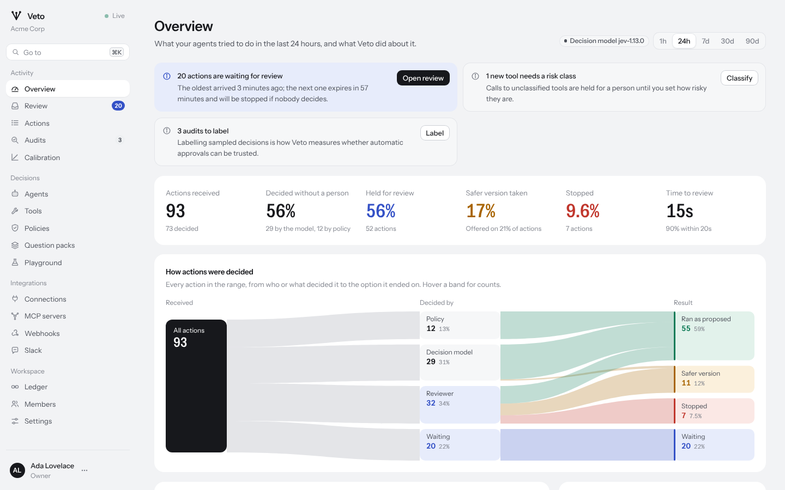
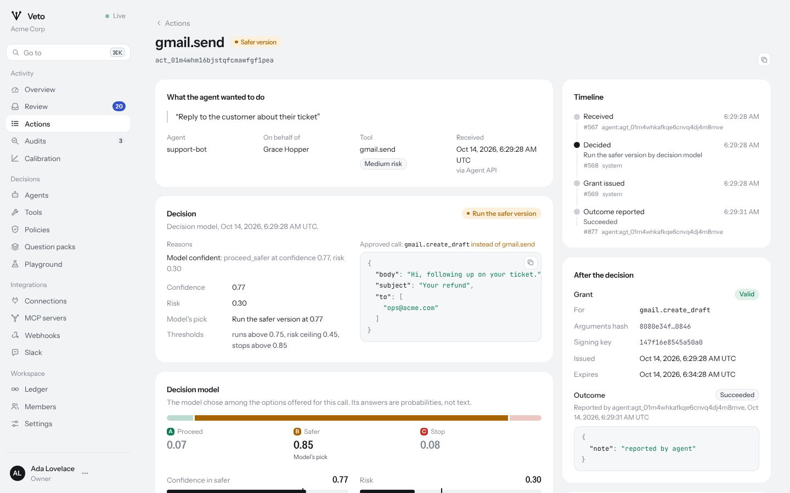
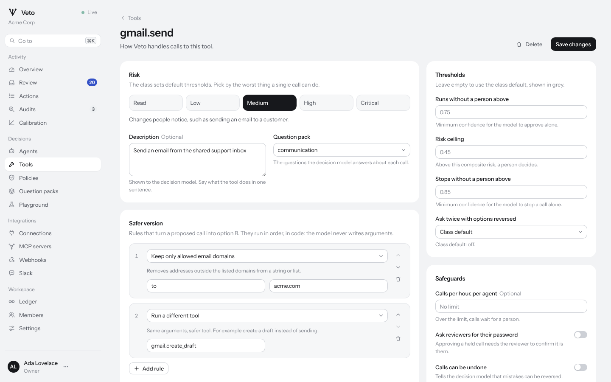

# The console

The console is where people see what agents are doing, decide what Veto
held, and configure the workspace. It updates live: every page that shows
actions refreshes as events arrive over a server-sent event stream, and the
sidebar shows **Live** while the stream is connected.

Press `⌘K` (or `Ctrl K`) anywhere to jump to a page, an agent or a tool, or
paste an action id to open it. The theme follows your system; change it
from the menu under your name.

## Activity

**Overview.** For a time range (1 hour to 90 days):

- what needs attention now: actions waiting for review with the next
  deadline, new tools that need a risk class, and audits to label;
- headline figures: actions received, the share decided without a person,
  held, the safer version taken, stopped, and the median time to review;
- **How actions were decided**: every action in the range as a flow from
  who decided it (policy, the model, a reviewer, expiry) to how it ended
  (as proposed, the safer version, stopped, still waiting). Hover a band
  for counts;
- actions over time, split by how they ended, beside the latest actions as
  they arrive;
- the decision model's latency (median and 95th percentile), errors and
  token use;
- the risk distribution of assessed actions, the rate of wrong automatic
  approvals found by audits, and bad outcomes;
- the most active tools and agents, and why actions were held.

**Review.** The queue of held actions, soonest deadline first, with the
selected action's context, reasons, the three options and the model's view.
See [Reviewing held actions](reviewing.md).

**Actions.** Every action, filterable by result, option, who decided,
agent, tool and time, with full-text search over requests, tools and ids.
**Export loaded rows** downloads them as CSV. Open any action for its
complete record:

- what the agent wanted, who it acted for, and any untrusted content;
- the decision, who made it and when, the reasons, the thresholds that
  applied, and the exact call that was approved;
- the decision model's probabilities, confidence, risk, guards, double
  check and every signal;
- the options, with a diff of the safer version;
- each evaluation with the exact request sent to the model and its
  response;
- a timeline from the ledger, grants, outcomes, the audit, and the hashes
  that prove the record.

**Audits.** Decisions to label and the labels given. See
[Calibration and audits](calibration.md).

**Calibration.** The reliability chart and suggested thresholds per tool.

## Decisions

**Agents.** Each agent's activity over seven days, its keys, and its recent
actions. Add agents, issue and revoke keys, and disable an agent, which
stops everything it sends.

**Tools.** Every tool agents have called, with calls, holds, stops and
average confidence. A tool's page sets its risk class, question pack,
thresholds, safer-version rules (with a preview), hourly limit, step-up and
fail mode.

**Policies.** A Cedar editor that checks as you type, the rules in a
version, and every version with activation.

**Question packs.** The built-in and custom packs: their decision criteria,
signals and guards, a JSON editor, and history.

**Playground.** Runs a call through everything Veto would do, without
recording it: the policy result, the options, the request to the model and
its answer, and the verdict.

## Integrations

**Connections**, **MCP servers**, **Webhooks** (with each endpoint's recent
deliveries and payloads) and **Slack**.

## Workspace

**Ledger.** Every entry, newest first, filterable by kind or action, with
its payload and hashes; signed checkpoints; and **Verify the chain**.

**Members.** People, roles and invitations. Veto does not send email:
creating an invitation gives you a link to share.

**Settings.** The workspace's review timeout, audit sample rate, retention,
untrusted content limit and calibration target; your name and password;
admin API keys; and the server's version, model, configuration and signing
keys.

## Roles

|                                                        | Viewer | Reviewer | Admin | Owner |
| ------------------------------------------------------ | ------ | -------- | ----- | ----- |
| See everything                                         | yes    | yes      | yes   | yes   |
| Decide held actions, label audits                      |        | yes      | yes   | yes   |
| Configure agents, tools, policies, packs, integrations |        |          | yes   | yes   |
| Manage members and workspace settings                  |        |          | yes   | yes   |
| Invite owners, create admin keys, rotate signing keys  |        |          |       | yes   |

The console hides what your role cannot do; the server enforces it.
