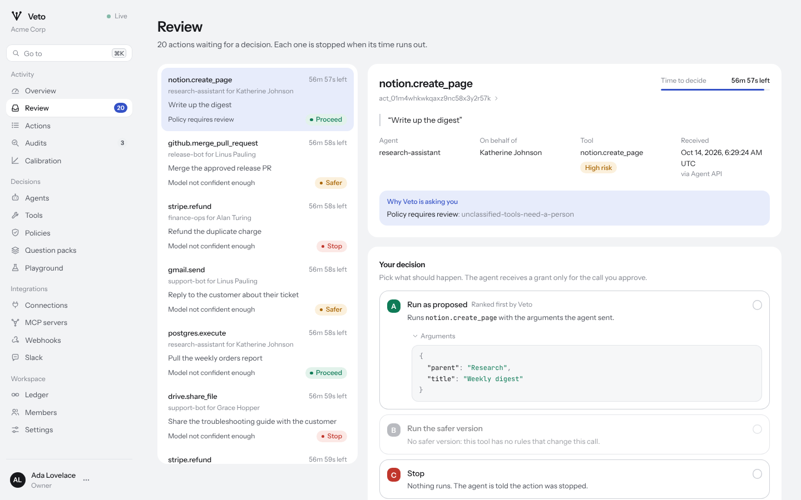

# Reviewing held actions

When Veto is not sure, it asks a person. This guide is for reviewers.

## Where held actions appear

- **Review** in the console: the queue, soonest deadline first. The count
  is in the sidebar and the browser tab.
- Slack, if your workspace connected it: a message per held action with a
  button for each option. See [Slack](slack.md).
- Your own tools, through the `action.pending_review` webhook, which is
  sent again halfway to the deadline if nobody has decided.

## Deciding

Each held action shows:

- what the agent was asked to do, who it acts for, and any untrusted
  content it read, flagged as such;
- why Veto is asking: the reasons, such as low confidence or a guard;
- the three options. **A** shows the exact arguments. **B** shows the
  changes the tool's rules made and a diff against A. **C** stops it;
- what the decision model thought: its probabilities for each option, its
  confidence against the tool's threshold, the risk against the ceiling,
  and every signal behind the risk.

Pick an option, add a note if it helps (the agent receives it), and
confirm. The agent receives a grant only for the call you approved.

Keyboard: `1`, `2`, `3` (or `A`, `B`, `C`) choose an option, `Enter`
confirms, `J` and `K` move through the queue.

## Step-up

Tools marked **Ask reviewers for their password** require you to enter
your password to approve option A or B. Stopping never needs it. Use this
for tools where a stolen session should not be enough, such as payments.
Approvals for these tools can only be made in the console: Slack buttons
and admin API keys can stop such an action but not approve it.

## Deadlines

Each held action has a deadline: the workspace's review timeout (one hour
by default, under **Settings**). When it passes, the action expires and is
stopped (`decided_by: expiry`). The last tenth of the window is shown in
red.

## Who can review

Owners, admins and reviewers can decide held actions and label audits.
Viewers can see everything and decide nothing. Admin API keys can review
through `POST /v1/actions/{id}/review`, for teams that build their own
review flow.

## Your decisions are labels

Every review is also a label for calibration: Veto compares what you chose
with what the model chose at that confidence. Choose what you would want
done, not what you think the model expected. See
[Calibration and audits](calibration.md).
